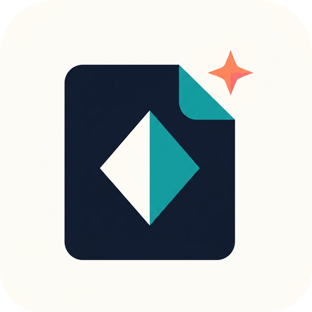
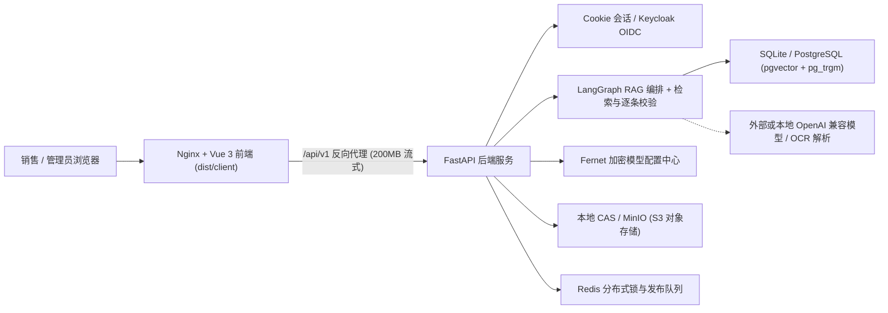

<div align="center">



# SalesPilot AI

**面向企业销售与售前团队的多品类智能产品选型与 RAG 知识库工作台**
<br />
*Enterprise Multi-Category Product Selection & RAG Knowledge Workspace*

<p>
  <a href="https://github.com/Du-professor/salespilot-ai/releases/tag/v0.1.0"></a>
  
  
  
  
  
  
  <a href="#english-documentation"></a>
</p>

**[简体中文](#中文文档) · [English](#english-documentation)**

</div>

---

## 中文文档

> [Switch to English ↗](#english-documentation)

SalesPilot AI 是面向企业销售与售前团队的多品类智能产品选型与 RAG 知识库工作台。团队上传产品规格书或技术手册后，销售可直接用客户原话发起选型对话，获取基于手册硬性指标比对的型号推荐、可追溯原文引用以及可下载的原件手册与 Markdown 推荐报告。

### 核心功能

| 模块 | 能力说明 |
| --- | --- |
| **多知识库与资料版本** | 支持创建多知识库与多级文件夹、选择本地或远程向量模型、批量上传（PDF / DOCX / Markdown / TXT）、版本发布/撤回/删除、原件与索引片段查看、检索诊断测试及后台索引重建与版本切换/回滚。 |
| **对话式智能产品选型** | 支持自然语言需求输入与多轮追问澄清，基于已授权且已发布资料执行检索与硬性参数核验，返回推荐型号、依据、待确认项、逐条出处引用及手册/报告附件；支持按日期分组、搜索、重命名、置顶与删除会话。 |
| **推荐历史自动归档** | 当回复附带手册或推荐报告时自动归档，支持刷新与重启后追溯；当作为依据的资料版本被撤回或删除时，自动复核并失效对应引用与附件下载权限。 |
| **统一模型 API 配置** | 管理员可配置、Fernet 加密保存并探测验证 `chat`、`embedding`、`rerank` 与外部 `parser` 服务，支持 DeepSeek、Kimi、智谱 GLM、OpenAI、MiniMax、Ollama 及任意 OpenAI 兼容端点，并支持实时切换。 |
| **多形态权限与部署** | 轻量单机模式（同源 Cookie 会话 + SQLite + 本地 CAS 存储）开箱即用；企业全栈模式（PostgreSQL 16 + `pgvector` + `pg_trgm`、MinIO/S3、Redis 分布式锁/队列、Keycloak OIDC + 知识库 ACL）面向生产扩展。 |

### 系统架构



### Docker 部署（推荐直接交由 AI 助手或使用 Docker Compose）

仓库包含完整的容器化部署文件，无需在本机手工搭建前后端运行环境：

- `Dockerfile.web`：前端多阶段构建与 Nginx 静态托管镜像
- `backend/Dockerfile` & `backend/entrypoint.sh`：FastAPI + RAG 后端镜像与启动入口
- `docker-compose.yml`：轻量单机版编排（`web` + `backend` + SQLite 持久化卷）
- `docker-compose.enterprise.yml`：企业全栈编排（`web` + `backend` + PostgreSQL/pgvector + Redis + MinIO + Keycloak）
- `deploy/nginx.conf`：Nginx 反向代理与 200 MB 无缓冲流式上传配置
- `.env.example`：环境变量配置模板

#### 部署步骤

1. 从模板生成 `.env`，生成随机 32 字节 Fernet 主密钥填入 `SALESPILOT_MODEL_CONFIG_KEY`，并修改默认演示/数据库密码与 `SALESPILOT_WEB_ORIGINS`：

   ```bash
   cp .env.example .env
   python3 -c "import os, base64; print(base64.urlsafe_b64encode(os.urandom(32)).decode())"
   ```

2. 按部署规模启动容器：

   - **轻量单机版**（`web` + `backend`）：

     ```bash
     docker compose -f docker-compose.yml up -d --build
     ```

   - **企业全栈版**（`web` + `backend` + PostgreSQL/pgvector + Redis + MinIO + Keycloak）：

     ```bash
     docker compose -f docker-compose.enterprise.yml up -d --build
     ```

3. 启动后访问 `http://127.0.0.1:4173/`（可通过管理员账号登录「模型 API 配置」页面添加并测试外部对话、向量、重排或解析端点）。

#### 关键环境变量与模型支持

| 变量 | 说明 |
| --- | --- |
| `SALESPILOT_MODEL_CONFIG_KEY` | 必填，32 字节 urlsafe base64 Fernet 主密钥，用于服务端加密存储模型 API 密钥 |
| `SALESPILOT_MODEL_ALLOWED_BASE_URLS` | 允许管理员填写的私有/自定义模型与解析网关地址白名单（逗号分隔） |
| `SALESPILOT_WEB_ORIGINS` | 允许访问后端的前端来源列表（逗号分隔，生产环境请填真实域名） |
| `SALESPILOT_RAG_MODE` | 后端检索运行模式（默认 `demo` 离线哈希模式，生产可结合模型配置中心使用外部接口） |
| `SALESPILOT_DEMO_PASSWORD_A` / `_B` | 轻量演示模式初始化账号 `sales-a` / `sales-b` 密码（12–256 位） |
| `POSTGRES_*` / `MINIO_ROOT_*` / `KC_ADMIN_*` / `SALESPILOT_OIDC_*` | 企业全栈版 PostgreSQL、MinIO 与 Keycloak OIDC 配置 |

支持的模型供应商预设包括 **DeepSeek**、**Kimi**、**智谱 GLM**、**OpenAI**、**MiniMax**、**Ollama** 以及任意 **OpenAI 兼容接口**。

### Git 版本存档与回档指南

仓库已配置 `.gitattributes`、自动清理远端失效分支（`fetch.prune=true`）与快进合并策略（`pull.ff=only`），并建立里程碑存档标签（如 `v0.1.0`），便于版本归档与安全回滚：

- **日常同步与存档提交**（提交前请先确保不含有 `.env`、密钥或本地数据库）：
  ```bash
  git status -sb
  git add <修改文件>
  git commit -m "feat: 描述本次改动"
  git push origin main
  ```
- **创建里程碑标签存档**（建议每次发布或大改动前打 Tag）：
  ```bash
  git tag -a v0.1.1 -m "Archive: 描述本版本快照"
  git push origin v0.1.1
  ```
- **查看历史存档记录**：
  ```bash
  git tag -n
  git log --oneline --decorate -n 20
  ```
- **安全回档（推荐）**：
  - 基于指定标签拉出回档分支检查/部署（不破坏现有历史）：
    ```bash
    git checkout -b rollback-v0.1.0 v0.1.0
    ```
  - 安全撤销主分支上某次已推送的提交（生成反向提交，保留完整审计记录）：
    ```bash
    git revert <commit-hash>
    git push origin main
    ```

### 安全与隐私说明

- 仓库中不包含任何生产密钥、真实客户资料、企业内部信息或运行期数据库文件。
- 模型 API 密钥在服务端使用 `SALESPILOT_MODEL_CONFIG_KEY` 加密落盘，绝不回传浏览器；`fixtures/` 下仅保留自动化测试使用的合成规格数据。
- 生产环境上线前，请务必替换 `.env` 中的默认账号密码、中间件口令及 `SALESPILOT_WEB_ORIGINS`。

### 开发约定

AI 助手或开发者修改代码、验证构建与打包产物时，请遵循 [agent.md](agent.md)。

---

## English Documentation

> [切换至简体中文 ↗](#中文文档)

SalesPilot AI is an enterprise multi-category product selection and RAG knowledge workspace built for sales and pre-sales engineering teams. After uploading product datasheets or technical manuals, sales engineers can ask questions using a customer's original requirements and receive verified model recommendations backed by line-by-line citations, original manual downloads, and generated Markdown recommendation reports.

### Key Features

| Module | Capabilities |
| --- | --- |
| **Knowledge Bases & Document Versions** | Multi-knowledge-base & nested folder organization, per-KB embedding model selection, batch uploads (PDF / DOCX / Markdown / TXT), version publishing/withdrawal/deletion, chunk & original file inspection, retrieval diagnostics, background index rebuilds, and zero-downtime index switching/rollback. |
| **Conversational Product Selection** | Natural-language requirement capture and multi-turn clarification. Enforces published & authorized scope, evaluates hard technical constraints, and returns recommended models, rationale, open questions, grounded citations, and downloadable manuals/reports. Includes conversation search, pinning, renaming, and deletion. |
| **Auto-Archived Recommendation History** | Automatically archives turns that produce manuals or reports across refreshes and restarts; automatically invalidates citations and attachment access whenever a referenced manual version is withdrawn or deleted. |
| **Unified Model API Center** | Admin workspace to configure, Fernet-encrypt, probe-test, and hot-switch `chat`, `embedding`, `rerank`, and external `parser` (OCR/layout) endpoints for DeepSeek, Kimi, Zhipu GLM, OpenAI, MiniMax, Ollama, and custom OpenAI-compatible gateways. |
| **Flexible Deployment & Enterprise Auth** | **Lite Mode** (same-origin cookie auth + SQLite + local CAS store) for rapid standalone runs; **Enterprise Stack** (PostgreSQL 16 + `pgvector` + `pg_trgm`, MinIO/S3, Redis distributed locks/publish queue, Keycloak OIDC + KB-level ACLs) for production scale. |

### Docker Deployment (Recommended via AI Assistant or Docker Compose)

The repository ships complete container manifests without requiring local Python/Node toolchain setup:

- `Dockerfile.web`: Multi-stage frontend build served by Nginx
- `backend/Dockerfile` & `backend/entrypoint.sh`: FastAPI + RAG backend image and entrypoint
- `docker-compose.yml`: Lite standalone stack (`web` + `backend` + persistent SQLite volume)
- `docker-compose.enterprise.yml`: Enterprise stack (`web` + `backend` + PostgreSQL/pgvector + Redis + MinIO + Keycloak)
- `deploy/nginx.conf`: Reverse proxy with 200 MB unbuffered streaming uploads
- `.env.example`: Environment template

#### Deployment Steps

1. Copy `.env.example` to `.env`, generate a random 32-byte URL-safe base64 Fernet master key for `SALESPILOT_MODEL_CONFIG_KEY`, and replace all default passwords and `SALESPILOT_WEB_ORIGINS`:

   ```bash
   cp .env.example .env
   python3 -c "import os, base64; print(base64.urlsafe_b64encode(os.urandom(32)).decode())"
   ```

2. Start the stack matching your target environment:

   - **Lite Standalone** (`web` + `backend`):

     ```bash
     docker compose -f docker-compose.yml up -d --build
     ```

   - **Enterprise Full-Stack** (`web` + `backend` + PostgreSQL/pgvector + Redis + MinIO + Keycloak):

     ```bash
     docker compose -f docker-compose.enterprise.yml up -d --build
     ```

3. Open `http://127.0.0.1:4173/` and sign in with an admin account to configure and verify external model APIs under the Model Configuration view.

#### Key Environment Variables & Supported Providers

| Variable | Description |
| --- | --- |
| `SALESPILOT_MODEL_CONFIG_KEY` | Required 32-byte URL-safe base64 Fernet master key for encrypting stored model API keys |
| `SALESPILOT_MODEL_ALLOWED_BASE_URLS` | Comma-separated allowlist of custom/private model or parser gateway base URLs |
| `SALESPILOT_WEB_ORIGINS` | Comma-separated allowed frontend origins for CORS/CSRF checks |
| `SALESPILOT_RAG_MODE` | Retrieval execution mode (defaults to offline `demo` hash mode; pair with Model API Center for external inference) |
| `SALESPILOT_DEMO_PASSWORD_A` / `_B` | Demo account passwords for `sales-a` / `sales-b` (12–256 chars) |
| `POSTGRES_*` / `MINIO_ROOT_*` / `KC_ADMIN_*` / `SALESPILOT_OIDC_*` | Enterprise PostgreSQL, MinIO/S3, and Keycloak OIDC settings |

Built-in provider presets include **DeepSeek**, **Kimi**, **Zhipu GLM**, **OpenAI**, **MiniMax**, **Ollama**, and any **OpenAI-compatible endpoint**.

### Git Archiving & Rollback Guide

This repository includes `.gitattributes`, `fetch.prune=true`, `pull.ff=only`, and annotated milestone tags (starting at `v0.1.0`) for clean archiving and safe rollback:

- **Sync & Archive Changes**:
  ```bash
  git status -sb
  git add <changed-files>
  git commit -m "feat: describe changes"
  git push origin main
  ```
- **Create Milestone Tag**:
  ```bash
  git tag -a v0.1.1 -m "Archive: milestone snapshot"
  git push origin v0.1.1
  ```
- **Inspect Archives**:
  ```bash
  git tag -n
  git log --oneline --decorate -n 20
  ```
- **Safe Rollback**:
  - Branch from a known-good archive tag without rewriting shared history:
    ```bash
    git checkout -b rollback-v0.1.0 v0.1.0
    ```
  - Revert a pushed commit cleanly on `main` while preserving audit history:
    ```bash
    git revert <commit-hash>
    git push origin main
    ```

### Security & Privacy

- Zero production keys, customer manuals, internal credentials, or runtime databases are tracked in Git.
- Model API keys are encrypted at rest on the server via `SALESPILOT_MODEL_CONFIG_KEY` and never returned to the browser; `fixtures/` contains synthetic test specifications only.
- Always change default passwords, middleware secrets, and `SALESPILOT_WEB_ORIGINS` in `.env` before exposing any deployment beyond localhost.

### Development Rules

For coding boundaries, Sites packaging constraints, and verification commands, refer to [agent.md](agent.md).
